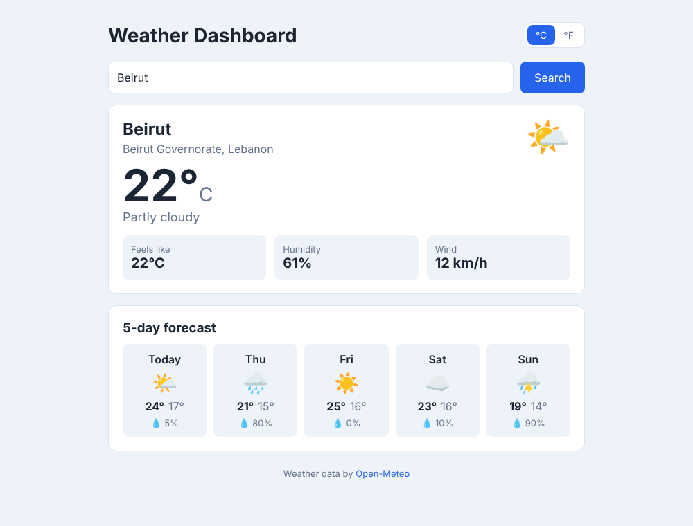

# Weather Dashboard (React)

Assignment 5 – React Multi-Component Application.

This is my Assignment 4 Weather Dashboard rebuilt in **React** with **Vite**. You search for a city and the app shows the current weather (temperature, conditions, feels like, humidity, wind) and a 5-day forecast. You can switch between °C and °F.



## How to install and run

You need **Node.js 20.19+ or 22.12+** (Vite 8 needs one of these). Check your version with `node -v`.

```bash
# 1. go into the project folder
cd weather-dashboard-react

# 2. install the dependencies (creates node_modules)
npm install

# 3. start the dev server
npm run dev
```

Then open the link Vite shows in the terminal (usually **http://localhost:5173**).

Other scripts:

| Command           | What it does                                  |
| ----------------- | --------------------------------------------- |
| `npm run dev`     | starts the dev server with hot reload         |
| `npm run build`   | builds the production version into `dist/`    |
| `npm run preview` | serves the `dist/` build to check it locally  |
| `npm run lint`    | checks the code with oxlint                   |

### API key

The app uses the [Open-Meteo API](https://open-meteo.com/). It is free and **does not need an API key**, so there is nothing to set up. You just need an internet connection.

## Features

- Search any city (press Enter or click Search)
- Current weather card + 5-day forecast with chance of rain
- °C / °F toggle (it converts on the screen, so it does not send a new request)
- Loading spinner, clear error messages, and a "Try again" button for network errors
- Remembers the last city and unit for the next visit (localStorage)
- Responsive: the forecast turns into a list on phones, plus dark mode support

## Project structure

```
src/
├── main.jsx                  # starts React and renders <App />
├── App.jsx                   # main component: holds the shared state
├── index.css                 # all the styles
├── components/
│   ├── SearchBar.jsx         # search form (controlled input)
│   ├── UnitToggle.jsx        # °C / °F buttons
│   ├── LoadingSpinner.jsx    # loading state
│   ├── ErrorMessage.jsx      # error state (+ optional Try again button)
│   ├── WeatherCard.jsx       # current weather (success state)
│   ├── WeatherDetail.jsx     # one small label/value box, reused 3 times
│   ├── ForecastList.jsx      # the 5-day forecast
│   └── ForecastDay.jsx       # one day in the forecast
├── hooks/
│   └── useWeather.js         # custom hook: useEffect that fetches the weather
└── utils/
    ├── weather.js            # API requests + helpers (icons, °C→°F, day names)
    └── storage.js            # safe localStorage read/write
```

Every component is a function component in its own file. There are no class components.

## Component tree

```
App  (state: city, unit)
├── UnitToggle      ← unit, onChange
├── SearchBar       ← initialCity, onSearch, isLoading   (state: text)
├── LoadingSpinner  ← message                            (status = loading)
├── ErrorMessage    ← message, onRetry                   (status = error)
├── WeatherCard     ← place, current, unit               (status = success)
│   └── WeatherDetail ×3  ← label, value
└── ForecastList    ← days, unit                         (status = success)
    └── ForecastDay ×5    ← day, index, unit
```

## How I used the hooks

### useState

| State        | Where it lives  | Why there                                                                          |
| ------------ | --------------- | ---------------------------------------------------------------------------------- |
| `text`       | `SearchBar`     | the text being typed. Only the search form needs it, so it stays local.           |
| `city`       | `App`           | the city that was searched. The hook and the loading message need it.            |
| `unit`       | `App`           | °C or °F. The toggle changes it and both cards read it, so I **lifted it up** to App. |
| `weather`    | `useWeather`    | the data that came back from the API                                              |
| `status`     | `useWeather`    | `'idle' / 'loading' / 'success' / 'error'`, one value instead of several booleans that could disagree |
| `error`      | `useWeather`    | the error message and whether retrying makes sense                                |
| `retryCount` | `useWeather`    | changing it re-runs the effect, used by "Try again" and by searching the same city again |

I did **not** put things in state that can be computed from other values. For example, the °F temperatures are calculated while rendering from the °C data and `unit`, and `isLoading` is just `status === 'loading'`.

### useEffect

1. **Fetching the weather** (`hooks/useWeather.js`), dependency array `[city, retryCount]`. It runs when a new city is searched or when the user clicks "Try again". `unit` is **not** a dependency because changing units doesn't need new data. The effect uses an `AbortController`, and its cleanup function cancels the old request. So if you search two cities quickly, the slower old answer can't replace the new one. This also handles React StrictMode running effects twice in development.
2. **Saving settings** (`App.jsx`): two small effects with `[city]` and `[unit]` save the last city and unit to localStorage.

I put the fetching inside a custom hook (`useWeather`) so `App` only has to decide *what to show*, and the fetching logic is in one place.

## Props and component communication

- **Parent → child (data):** `App` → `WeatherCard` (`place`, `current`, `unit`), `App` → `ForecastList` (`days`, `unit`), `ForecastList` → `ForecastDay` (`day`, `unit`), `WeatherCard` → `WeatherDetail` (`label`, `value`).
- **Child → parent (callbacks):** `SearchBar` calls `onSearch(city)` and `UnitToggle` calls `onChange(unit)`, so the children can change state that `App` owns. `ErrorMessage` calls `onRetry`.

### About prop drilling

The deepest a piece of state goes is **two levels**: `unit` goes `App → ForecastList → ForecastDay`. `ForecastList` really uses it (it passes it to each day it renders), so this is normal parent/child passing, not drilling through components that don't care about it. `WeatherDetail` doesn't get `unit` at all. `WeatherCard` formats the value and passes a ready string. Because nothing goes deeper than two levels, I didn't need Context or a state library. If the app grew (for example a settings page that also needs `unit`), I would move `unit` into a React Context.

## Testing I did

- `npm run lint` and `npm run build` finish with no errors or warnings
- Loading state: the spinner shows while the request is running and the Search button is disabled
- Error states: a city that doesn't exist ("zzzqqq") shows a "not found" message. Turning off the internet shows a connection error with a working "Try again" button.
- Success state: the card and forecast show and the °C/°F toggle updates both
- Checked at desktop width and at 375px (phone): no horizontal scrolling
- Refreshing the page keeps the last city and unit
- No uncaught errors and no `console.log` left in the code
